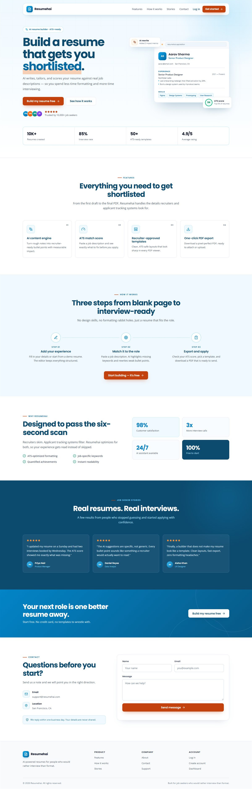

# Resumehai — AI Resume Builder

An AI-powered resume builder that creates professional, ATS-friendly, job-specific resumes — and helps you get shortlisted instead of filtered out.



## Overview

Resumehai is a full-stack MERN application for building, tailoring, scoring, and exporting resumes. It combines a real-time resume editor with AI content suggestions, job-description matching, ATS analysis, multiple recruiter-ready templates, and one-click PDF export.

The public landing page was rebuilt with a minimal Swiss-inspired design system and a conversion-focused flow: hero → features → how it works → social proof → CTA → contact.

## Features

### Resume creation

- **Real-time editor** — Split-screen editing with a live resume preview
- **AI content suggestions** — Improve bullet points, summaries, skills, achievements, and grammar
- **Job-specific tailoring** — Match resume content to a pasted job description
- **4 resume templates** — Modern, Classic, Minimal, and Creative
- **Accent color picker** — 9 presets plus a custom color option
- **Font selector** — Default, Serif, Mono, and Handwriting styles
- **Profile photo upload** — Base64 storage with change/remove support
- **Certificate uploads** — Attach PDF or image files to certifications
- **PDF export** — Download a polished, print-ready resume
- **Demo resumes** — Start quickly from four example profiles

### ATS and job matching

- **ATS score checker** — Overall score with category-level breakdowns
- **Keyword analysis** — Missing and matched keywords for a target role
- **Strengths and improvements** — Actionable suggestions to improve the resume
- **Local fallback scoring** — ATS analysis works even without an OpenAI API key

### Landing page

- **New responsive design** — Minimal Swiss layout with a sky-blue and warm-CTA palette
- **Floating navigation** — Accessible mobile menu with clear focus states
- **Product-led hero** — Resume mockup, ATS score preview, trust signals, and key stats
- **Conversion sections** — Feature grid, three-step workflow, testimonials, and CTA band
- **Accessible contact form** — Visible labels, status feedback, and keyboard-friendly controls
- **Responsive at every size** — Verified from 320px to 1440px without horizontal overflow
- **WCAG 2.1 AA validated** — Axe audit reports zero violations on desktop and mobile
- **SEO-ready metadata** — Descriptive title, meta description, and a custom favicon

### Accounts and security

- **JWT authentication** — Secure register, login, and session handling
- **Password hashing** — bcrypt-based password storage
- **Private dashboard** — Each user manages only their own resumes
- **Dark mode** — Theme support across the application

## Tech Stack

| Layer | Technology |
|-------|------------|
| Frontend | React 18, Vite 5, React Router 6 |
| Styling | CSS custom properties, responsive CSS |
| Icons | lucide-react |
| Backend | Node.js, Express 4 |
| Database | MongoDB, Mongoose |
| Authentication | JWT, bcryptjs |
| AI | OpenAI GPT-3.5-turbo with local fallback |
| PDF export | html2pdf.js |
| Notifications | react-hot-toast |
| Fonts | Poppins, Open Sans, Inter, Caveat, Fira Code |

## Design System

The landing page uses a scoped design system in `resume-builder/client/src/styles/landing.css`.

| Token | Value |
|-------|-------|
| Primary | `#0EA5E9` |
| Deep navy | `#0C4A6E` |
| CTA | `#C2410C` |
| Background | `#F0F9FF` |
| Surface | `#FFFFFF` |
| Text | `#0C4A6E` |
| Body text | `#475569` |
| Heading font | Poppins |
| Body font | Open Sans |

Design principles: strong hierarchy, generous whitespace, visible borders, restrained effects, 150–300ms transitions, visible focus indicators, and `prefers-reduced-motion` support.

## Project Structure

```text
Resumehai/
├── docs/
│   └── screenshots/
│       └── landing-page.jpg
├── resume-builder/
│   ├── client/
│   │   ├── public/
│   │   │   └── favicon.svg
│   │   ├── src/
│   │   │   ├── components/       # Navbar, ATS panel, AI assistant, preview
│   │   │   ├── context/          # Auth context
│   │   │   ├── data/             # Demo resumes
│   │   │   ├── pages/            # Landing, auth, dashboard, editor, preview
│   │   │   ├── services/         # Axios API client
│   │   │   ├── styles/           # Landing page design system
│   │   │   ├── App.jsx
│   │   │   ├── index.css
│   │   │   └── main.jsx
│   │   ├── index.html
│   │   └── vite.config.js
│   ├── server/
│   │   ├── middleware/           # JWT auth middleware
│   │   ├── models/               # User and Resume schemas
│   │   ├── routes/               # Auth, resumes, AI routes
│   │   └── index.js
│   ├── .env.example
│   ├── README.md                 # Detailed application documentation
│   └── package.json
├── .opencode/
│   └── skills/
│       └── ui-ux-pro-max/        # UI/UX design intelligence skill
└── README.md
```

## Getting Started

### Prerequisites

- Node.js 18+
- MongoDB (local or MongoDB Atlas)
- OpenAI API key (optional — ATS scoring works without one)

### 1. Install dependencies

```bash
cd resume-builder
npm run install:all
```

### 2. Configure environment variables

```bash
cd resume-builder
cp .env.example .env
```

Update `.env` with your MongoDB connection string, JWT secret, and optional OpenAI key.

### 3. Start MongoDB

```bash
mongod
```

### 4. Run the development servers

```bash
cd resume-builder
npm run dev
```

| Service | URL |
|---------|-----|
| Frontend | http://localhost:3000 |
| Backend | http://localhost:5000 |

## Environment Variables

| Variable | Description | Required |
|----------|-------------|----------|
| `PORT` | Backend port | No (default: `5000`) |
| `MONGODB_URI` | MongoDB connection string | Yes |
| `JWT_SECRET` | Secret used to sign JWT tokens | Yes |
| `OPENAI_API_KEY` | OpenAI API key | Optional |
| `VITE_API_URL` | Frontend API base URL | Yes (default: `http://localhost:5000/api`) |

## Available Scripts

Run these from `resume-builder/`:

| Command | Description |
|---------|-------------|
| `npm run install:all` | Install root, server, and client dependencies |
| `npm run dev` | Start client and server together |
| `npm run dev:client` | Start the Vite frontend |
| `npm run dev:server` | Start the Express backend with nodemon |
| `npm run build` | Build the production frontend |
| `npm start` | Start the production backend |

## API Overview

### Auth

- `POST /api/auth/register` — Create an account
- `POST /api/auth/login` — Log in
- `GET /api/auth/me` — Get the current user

### Resumes

- `GET /api/resumes` — List the user's resumes
- `POST /api/resumes` — Create a resume
- `GET /api/resumes/:id` — Get a resume
- `PUT /api/resumes/:id` — Update a resume
- `DELETE /api/resumes/:id` — Delete a resume
- `POST /api/resumes/:id/duplicate` — Duplicate a resume

### AI

- `POST /api/ai/suggest` — Get an AI suggestion for a field
- `POST /api/ai/ats-score` — Score a resume against a job description
- `POST /api/ai/analyze` — Run a full resume analysis

## Templates

1. **Modern** — Clean professional layout with a blue accent
2. **Classic** — Traditional serif design with formal borders
3. **Minimal** — Maximum whitespace and understated typography
4. **Creative** — Gradient header and distinctive color blocks

Each template supports accent colors, font overrides, profile photos, and certification attachments.

## Deployment

### Backend

1. Set the environment variables on your host (Render, Railway, Fly.io, etc.)
2. Install dependencies: `cd server && npm install`
3. Start: `npm start`

### Frontend

1. Build: `cd client && npm run build`
2. Deploy the generated `dist/` directory to Vercel, Netlify, or similar
3. Set `VITE_API_URL` to your deployed backend API URL

## Documentation

- [Detailed application README](resume-builder/README.md)
- [Landing page design system](resume-builder/client/src/styles/landing.css)
- [UI/UX design skill](.opencode/skills/ui-ux-pro-max/SKILL.md)

## License

MIT
